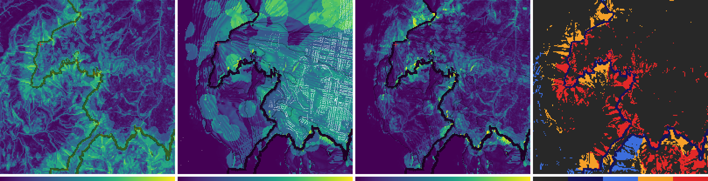
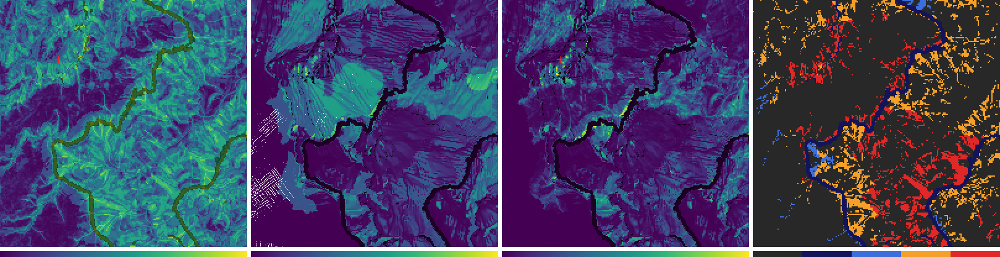
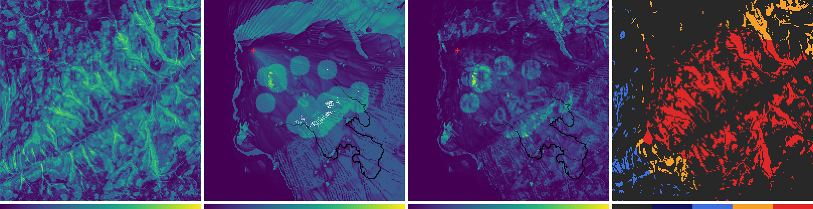
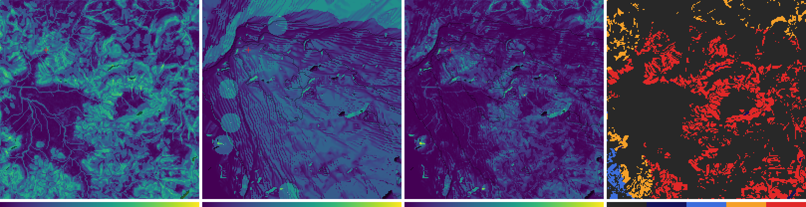

# Adaptive simulation quality

A topic whose first step, a desk analysis that changes nothing in the simulation, was done on 2026-11-07 (section [Desk analysis: the quality map (2026-11)](#desk-analysis-the-quality-map-2026-11)). Nothing is designed or built. **Question:** is it possible to increase the quality of the simulation according to the complexity of the
terrain and its importance to the fire?

**Status:** a stretch goal in no release ([plan](../../docs/plans/air-slice-wind-detail-honest-speed.md) section 15c, decision D30).
The owner said go for the first step only (2026-11-07); the rest is not started. This page keeps the question, what the code already says about it,
and the desk analysis. The analysis lives directly in this folder (`scripts/`, `data/`, `figures/`), not in a numbered study folder.

## Why it matters

- The fire and the air are computed at one resolution over the whole domain, but fire behaviour is not spread evenly: the front is a thin line,
  and the terrain that bends it (gullies, ridges, steep slopes, cliffs) is a small share of the area.
- Spending detail where it matters could give more quality for the same cost, or the same quality for less. The second matters on phones: in
  0.2.2, Auto chose the Fast (surface wind) model on the project owner's phone for a 3.6 % overshoot of its time budget (plan section 2).
- For training, the places a learner cares about are the ones near the front and near homes.

## Short answer so far

Yes in principle; nothing here is tested. Coupled fire models already do it: the atmosphere at one resolution and the fire on a finer mesh,
with nested domains (research note 07 section 2.1; WRF-SFIRE and ACCESS-Fire). What the app has today, and what could adapt (read from the code,
see plan section 15c):

| | Today | Could adapt |
|---|---|---|
| Fire grid | one cell size, 30 m, or 20 m in the high-detail setting up to 6 km (`src/scenario/params.ts`); the elevation data is 10 m | 10 m cells in boxes around the front where the terrain is complex |
| Level set | narrow band: rates only for unburnt cells within 4 cells of the front, time step from the fastest cell (`src/fire/spread/FireSpreadModel.ts`) | already front-local in cost; the detail is not |
| Air | one 150 to 200 m grid, one tier per run (Fast 2-D, or Standard or High 3-D) | a finer 3-D nest around the fire; could also make Detailed affordable on more phones |
| Embers | a cap per tier: 2000, 4000, 4000 (`src/sim/params.ts`) | more particles or finer steps near the front and near homes |
| Complex-terrain physics | only steep cells are candidates for lee separation and VLS | extend that gate to other expensive terms |
| Terrain complexity | measured per cell: landform, drainage, trench, slope P90, cliff fraction | a single "complexity" score |
| Importance | not measured | time until the front arrives, predicted spread, homes in the path, regime changes |

## Rules any design has to meet (plan section 4)

- **Rule 1:** results never depend on speed, display or statistics. Refinement has to be a pure function of the simulation state.
- **Rule 2:** no silent degradation. Refinement follows the terrain and the fire, never the load, and nothing changes "to keep up".
- **Rule 4:** honest labels. The map has to say where detail has been raised.
- Rewind and the determinism spec: refined state goes into the checkpoints.

## Open questions

Suggested order; none is started.

1. **How much of a domain needs fine treatment?** Build a quality map (complexity x importance) for the demo sites and measure the share of
   cells, and of run time, that are both important and complex. No change to the simulation. This sizes the possible gain before any design.
   *Done as a desk analysis on 2026-11-07, see the section below: at any moment the complex cells inside a 10-cell band ahead of the front are
   1 to 7 % of a 6 km domain, and the front reaches a median 43 % of the 20 % most complex cells within 4 h.*
2. **Does resolution change the answer, and where?** Run a bundled scenario at 30, 20 and 10 m and compare arrival times, perimeter and
   spotting. If the runs agree except around complex terrain, adaptivity pays; if they differ everywhere, the calibration depends on
   resolution and that has to be understood first. The same experiment, with a finer reference run, is how the
   [simulation-validity](../simulation-validity/README.md) topic would measure numerical error, so do it once for both.
3. **Which lever first?** Rank the four levers (physics gate, embers, fire mesh, air nest) by gain and cost. The physics gate and the embers
   look cheapest.
4. **Can the decision be deterministic and visible?** Write the refinement rule as a function of state, with a label for the map and a
   checkpoint story.
5. **Does an air nest make the Detailed mode affordable?** Measure on a phone how much of a 3-D step is spent away from the fire.
6. **Where do the formulas stop being valid?** The slope factor, its caps and the sub-cell terms were set for 20 to 30 m cells; check them at
   10 m.

## Desk analysis: the quality map (2026-11)

**Status:** done on 2026-11-07 as the first step of [plan section 15c](../../docs/plans/air-slice-wind-detail-honest-speed.md). It changes nothing in the simulation: no file under `src/`, `tests/`, `e2e/`, `docs/` or the package files was edited and no dependency was added. The real `Simulation` was run headless in Node and read, nothing more. It answers open question 1 (how much of a domain needs fine treatment) and gives a first look at question 3 (which lever first). It does **not** answer question 2 (does resolution change the answer): that needs the finer reference runs of the other two studies.

### The answer in short

Numbers are for the standard scenario below (a hot north-westerly day, one ignition, 8 simulated hours, fast tier) in a 6 km domain of 30 m cells, that is 40 000 cells and 3 600 ha, on each of the nine bundled sites. "Complex" is the top 20 % of cells by the first-definition complexity score (a cell count is also an area: all cells are 0.09 ha).

1. **Complex ground is a minority, but not a tiny one.** 24 to 63 % of the cells of a site score at least 0.4 (of 1) and 4 to 32 % at least 0.6. The top 20 % by rank is 720 ha. The cells the code already gates in as "steep" (slope 15 degrees or more, for lee separation and VLS) are 39 to 73 % of the domain, two to four times that set, and hold 89 to 95 % of it, so the existing gate is a wide filter, not a complexity filter.
2. **The front reaches only part of the complex cells in a training-length run.** Share of the top-20 % set that the front reaches (flammable and burnt) by 2 h, 4 h and 8 h: median over the nine sites 20 %, 43 % and 74 %; by 4 h it ranges from 17 % (Barrington Tops) to 78 % (Warrumbungles). Katoomba: 20, 43 and 67 %. Of that set 23 % at Katoomba and 22 % at Blackheath cannot burn at all (cliff cells are non-flammable barriers in the model).
3. **At any one moment far less needs fine treatment than the complex set.** The complex cells that lie inside the 10-cell (300 m) band ahead of the front are on average 1.1 to 6.7 % of the domain over the run (Katoomba 6.7 %, Blackheath 5.0 %, Thredbo 1.1 %), at their worst moment 3 to 9 %. A refinement fixed in advance on the top 20 % would have only 5 to 34 % of its cell-time near the front. Over the whole 8 h most complex cells are in that band at some time (83 to 99 % at eight sites, 60 % at Barrington Tops, where the fire reaches little), so the saving is in time, not in place.
4. **In cells (Katoomba, to 10 m):** uniform 10 m is 360 000 cells; the top 20 % refined for the whole run 104 000 (29 %); complex cells in the live 10-cell band 61 000 on average (17 %), 69 000 at the worst moment. To 20 m: uniform 90 000, fixed top 20 % 50 000 (56 %), live band and complex 43 000 (48 %). In cell-steps per simulated hour, relative to today's uniform 30 m (cost per cell-step assumed equal, step proportional to cell size): uniform 20 m 3.4 times, uniform 10 m 27 times; fixed top 20 % 1.5 times (20 m) and 6.2 times (10 m); live band and complex 1.2 times and 2.7 times. So the saving against uniform fine cells is large (about 6 times fewer cells and about 10 times fewer cell-steps at 10 m), but 10 m cells in the complex band would still cost about 2.7 times today's work.
5. **The fire solver is already front-local, so the front is not where a fire mesh would save.** Only the complexity filter is: it takes the cost of finer cells for the 4-cell band from 9.0 times today (uniform 10 m) to 5.9 times at Katoomba and 2.2 times at Thredbo (table T5b), by the share of the band that is complex.
6. **The air.** Share of the air columns within 1 km of the front, averaged over the run: 48 % over the first 2 h, 66 % over 4 h and 74 % over 8 h at Katoomba in the 6 km domain (43 to 74 % at 8 h across sites); in the 9 km bundled area 45 % at Katoomba and 40 % at Blackheath. In a 6 km domain a nest around the front covers most of the domain after the first hours, so a nest pays more in larger domains and early in a run. In the fast tier the air is not a cost at all (0.2 % of a step); in the Standard tier it is 64 to 70 % (this machine).
7. **How much to trust it.** One scenario per site, with six variants on two sites that move the numbers a lot (Katoomba top-20 % reached by 4 h: 43 % standard, 12 % with the ignition in the south-west, 3 % east, 0 % on a mild day). The complexity score is a first definition checked against no error measure. The sizes are less sensitive to the definition than the cells chosen are (table T9). Details and the list of what was not done are under Caveats.

### What is measured, what is computed, what is assumed

- **Measured** (real `Simulation` runs, 22 to 38 s of wall time each for the 6 km runs, 55 s for 9 km, 125 s on the Standard tier): arrival time of every cell, the local spread rate, the regime state the level set holds (junction boost, attachment A.E, active VLS zones), the insights, the mean level-set sub-steps per hour, and the share of a step each module takes on this (shared) machine. Two runs of the nine standard scenarios gave the same burnt area and spot count at every site (Katoomba 2 977 ha and 41 spot fires).
- **Computed from the bundled terrain:** the complexity components. The 10 m elevation is the NSW Spatial Services 5 m elevation model resampled to 10 m (the service describes it as derived from stereo imagery; it is not LiDAR), the same data the app bundles.
- **Defined by me, a first definition, nothing fitted to a result:** the complexity score, the importance score, the band widths, and the constants inside them (1 h, 1 m/s, 300 m, 30 min, the ramp edges).
- **Assumed, not measured:** the cost of one cell-step is 1 for every cell at every level; the level-set sub-step is proportional to the cell size (the CFL limit; where the 10 s outer step caps the sub-step, as in slow phases, this overstates the growth); in the "dense" accounting every cell is touched at every sub-step, which is **not** how the level set works today (it touches a band) but is how memory, moisture, fuel, layers and snapshots scale. Nothing finer than 30 m was run: all finer-cell costs are cell counts times these assumptions. The measured growth of time and memory with cell size is the work of the [desktop-simulation](../desktop-simulation/README.md) topic; when this analysis finished its folder `01-cost-vs-detail` held scripts and no results, so nothing here uses it. Compare it with the cell-step ratios below when it exists.

### The standard scenario (the same for every site, nothing tuned per site)

| | |
|---|---|
| Domain | 6 km square, centred on the site, cut from the bundled 9 km area: 200 x 200 cells of 30 m. The bundled data only (offline) |
| Tier and options | Fast tier (2-D diagnostic air, air grid 45 x 45 columns of 133 m), seed 1, embers on (the fast tier's cap of 2 000), mountain phenomena on |
| Weather | The designed preset "Hot NW wind ahead of a SW change": 36 C, 12 % RH, north-westerly 35 to 45 km/h, a south-westerly change at 15:00 local mean solar time (it registers in the series at 4 h 10 min). Started at its canonical 11:00 on 20 December 2026 |
| Ignition | One point (radius 30 m) at t = 0 on the flammable cell with slope under 10 degrees nearest to 1 500 m west and 1 500 m north of the centre, so that the wind drives the fire across the domain. The ignition cell is within 175 m of that point at every site (Kanangra 171 m, the others 130 m or less) |
| Window | 8 simulated hours (11:00 to 19:00), the fire polled every 30 s of simulated time. The window is the time for the fire to cross most of the domain (the alternative, 2 to 4 hours, was allowed within about 10 minutes of wall time): 8 hours took under 40 s a site, and the fire reached 79 to 98 % of the domain at eight sites and 61 % at Barrington Tops. Every table that matters also gives the 2 h and 4 h readings, which may be closer to the length of a training session (an assumption) |
| Variants (Katoomba and Blackheath only; Blackheath is the Grose Valley site, `grose` in file names) | ignition south-west, ignition east, the mild spring preset, the catastrophic preset, the whole 9 km area, the Standard tier (3-D air). Definitions in `scripts/lib/scenarios.ts` |

The homes data is present for four sites (Katoomba 4 126 address points in the domain, Blackheath 873, Thredbo 321, Mount Tomah 120) and almost absent for the others (Gospers 19, Warrumbungles 6, Kanangra 1, Pigeon House and Barrington Tops 0), so "homes in the path" carries weight only at the first four. The model's junction boost (spec 7.10) never fires in the Fast tier, because `FireSpreadModel.ts` skips junction detection while the pyrogenic wind is on (line 793) and `sim/simulation.ts` turns it on in the Fast tier (line 1081); it is empty in every Fast run here and fires (3 557 cells at Katoomba, 2 943 at Blackheath) in the Standard tier variant.

### Complexity: one simple score (first definition)

Five groups, each in [0, 1] from a linear ramp. Where the code already has a number, the ramp edge is that number. The score is the **plain mean of the five**: equal weights, because nothing says one reason matters more, and because any other weighting would be a guess I could only justify by the result. No weight and no edge was tuned to a result or to the data's distribution; the two edges with no number in the code (the last row) were fixed beforehand. Each group is kept as its own raster (`scripts/lib/analysis.ts`, `complexity()`).

| Group | Meaning | From | Ramp (0 to 1 between) and where the edge comes from |
|---|---|---|---|
| S steepness | slope that bends flow and the front | `features.slope30` (30 m slope), `terrain.slopeP90Deg` (90th percentile of the 10 m slopes in the cell) | the larger of slope30 15 to 25 degrees (the lee-separation edges `sep.slopeLoDeg`, `slopeHiDeg`; 15 is also the steep gate of `FireSpreadModel.ts` ~line 363) and slopeP90 30 to 60 degrees (above the VLS edge of 28 up to the cliff slope `cliffSlopeDeg` of 60) |
| C cliff | rock faces | `terrain.cliffFraction` | 0 to 0.3 (0.3 is the cliff-mask threshold `cliff.minFraction`) |
| G gully | channels and trenches | `features.trench` (score T of spec 7.6), `features.drainage` (upslope area 5 ha or more) | the larger of T and the drainage flag |
| L landform | classes that bend flow or the front | `terrain.landform` | 1 on Ridge, Spur, Gully, Saddle, Peak, Cliff, else 0 |
| R 10 m relief | shape the 30 m cell hides | the 10 m elevation: RMS height about the best plane in the 3 x 3 block, and the largest 5-point Laplacian (1/m) | the larger of RMS 0 to 3 m (3 m is a tenth of the cell) and Laplacian 0 to 0.02 per m (a 2 m kink against the mean of the four neighbours): fixed beforehand, not from the data |

Alternatives kept for the sensitivity check: the max of the five, the mean without L, and each group alone (table T9). "Steep gate" in the tables is slope30 of 15 degrees or more.

### Importance: a function of simulation state, not of load

Importance is read back from the finished run, per cell, as the plain mean of four parts:

- **time** `exp(-t_arrival / 1 h)` where the front reached the cell, else 0 (sooner is more important);
- **rate** `min(1, local spread rate / 1 m/s)` where reached, else 0 (the field's `ros`, the rate normal to the front at arrival; the cap of the model is 6 m/s);
- **home** 1 where reached and a home address point lies within 300 m of the cell centre, else 0;
- **regime** 1 where reached and one of the code's regime flags fired there: junction boost above 1, attachment A.E of 0.3 or more (`attachment.eruptiveAE`, the "eruptive: model indicative" threshold), an active vorticity-lateral-spread zone, or the front arrived within 30 min after the forecast wind change (the explain engine's card is held 20 min; 30 is used). The flags are the maxima over polls every 30 s of `aux.junction`, `aux.attach` and `aux.vlsActive`.

**Quality** is complexity times importance. As numbers, the share of cells with quality of at least 0.1, 0.2 and 0.3 (arbitrary levels, only to give the product a size) is 8 to 28 %, 1.4 to 9 % and 0.2 to 1.9 % across the nine sites (Katoomba 25 %, 6.6 % and 1.9 %). It is a retrospective, whole-run map: it is not a count of the cells needed at once, which is what the band rows of the tables give. **Ground rule, stated here so no later design loses it:** a refinement rule must be a pure function of the simulation state (burn state, the terrain, the scenario inputs and the state's own forecast), evaluated at fixed simulation times; it must follow the terrain and the fire and never the load, the display or the speed. This analysis reads importance back from a finished run, which is a perfect forecast of arrival; a rule that runs while the simulation runs has to predict arrival from the state (distance to the front and current rates), and how well that works was not tested here. The geometric band (distance to burnt ground) is the part that needs no forecast.

A forecast-style band (cells the finished run says the front reaches within 15, 30 or 60 min) is in `data/summary.json` as `horizon15min`, `horizon30min`, `horizon60min` but is not tabulated: its mean share is fixed by arithmetic, because every cell is in such a band for exactly H, so the mean share is the share reached times H over the run length (Katoomba, 30 min: 83 % x 0.5 h / 8 h = 5.1 %).

### Maps

Each picture has four panels, north up, one pixel pair per 30 m cell: complexity; importance with the front's position at 1, 2 and 4 h (black contours) and homes (white dots), the red cross is the ignition; quality (complexity times importance, scale 0 to 0.5); and the top 20 % of complexity by what the front did (dark grey: other cells; dark blue: cannot burn; blue: can burn but was not reached within 8 h; orange: reached between 4 and 8 h; red: reached within 4 h). Colour bars are the 0 to 1 scale (panel 4: the five categories in that order); cells that cannot burn are dimmed in panels 1 to 3. Terrain and home address points are NSW Spatial Services data, CC BY 4.0, bundled in `public/demo/` (home positions are drawn as dots, no addresses are stored in this folder).


*Katoomba 6 km: the cliff line of the escarpment (dimmed, non-flammable) runs through the complex ground; the town (white dots, north-east) lies in the path.*


*Blackheath, Grose Valley.*


*Thredbo Valley: no cliff cells, so all of the complex ground can burn, and 92 % of it is reached within 8 h.*


*Warrumbungle Range: the least complex of the nine; the fire reaches 98 % of the domain.*

Small rasters for all nine sites (complexity, importance, arrival in 5 min steps, can-burn mask) are in `data/<site>.quality.gz`; the format is in `scripts/lib/io.ts`.

### Results

All tables are made by `scripts/03_tables.mjs` from `data/summary.json`; the same text is in `data/tables.md`.

**T1. Terrain: how complex is each 6 km domain (30 m cells, 200 x 200 = 40 000 cells)**

| Site | Cells that can burn | Steep-gate cells (slope30 >= 15 deg) | Mean complexity | Complexity >= 0.4 | Complexity >= 0.6 | Top-20 % cells inside the steep gate | Cells with a group at >= 0.5: S / C / G / L / R |
|---|---|---|---|---|---|---|---|
| Katoomba | 96 % | 39 % | 0.28 | 31 % | 12 % | 94 % | 27 % / 3 % / 8 % / 34 % / 65 % |
| Blackheath | 96 % | 59 % | 0.36 | 47 % | 17 % | 92 % | 44 % / 3 % / 9 % / 45 % / 75 % |
| Mount Tomah | 96 % | 67 % | 0.40 | 55 % | 23 % | 90 % | 51 % / 2 % / 11 % / 56 % / 80 % |
| Kanangra Walls | 93 % | 73 % | 0.43 | 63 % | 32 % | 95 % | 64 % / 3 % / 13 % / 61 % / 76 % |
| Thredbo Valley | 100 % | 53 % | 0.29 | 31 % | 6 % | 92 % | 31 % / 0 % / 7 % / 43 % / 64 % |
| Gospers Mountain | 100 % | 63 % | 0.36 | 49 % | 9 % | 92 % | 39 % / 0 % / 8 % / 51 % / 85 % |
| Pigeon House Mountain | 99 % | 51 % | 0.32 | 39 % | 12 % | 90 % | 34 % / 0 % / 8 % / 46 % / 65 % |
| Barrington Tops escarpment | 98 % | 52 % | 0.33 | 42 % | 20 % | 95 % | 41 % / 0 % / 10 % / 45 % / 66 % |
| Warrumbungle Range | 100 % | 46 % | 0.26 | 24 % | 4 % | 89 % | 29 % / 0 % / 8 % / 43 % / 39 % |

**T2. The standard run: how much of the domain the front reached, and what changed regime**

| Site | Reached by 2 h | by 4 h | by 8 h | Homes in domain | Homes with burnt ground within 100 m by 4 h / 8 h | Junction boost / eruptive A.E / VLS zone / wind-change passage (cells, % of domain) |
|---|---|---|---|---|---|---|
| Katoomba | 29 % | 55 % | 83 % | 4 126 | 3 708 / 4 118 | 0 (0.0 %) / 63 (0.2 %) / 519 (1.3 %) / 5 291 (13.2 %) |
| Blackheath | 11 % | 39 % | 82 % | 873 | 49 / 228 | 0 (0.0 %) / 65 (0.2 %) / 1 130 (2.8 %) / 6 144 (15.4 %) |
| Mount Tomah | 8 % | 53 % | 79 % | 120 | 92 / 104 | 0 (0.0 %) / 117 (0.3 %) / 1 782 (4.5 %) / 3 755 (9.4 %) |
| Kanangra Walls | 7 % | 52 % | 82 % | 1 | 1 / 1 | 0 (0.0 %) / 312 (0.8 %) / 3 531 (8.8 %) / 5 270 (13.2 %) |
| Thredbo Valley | 21 % | 61 % | 84 % | 321 | 321 / 321 | 0 (0.0 %) / 3 (0.0 %) / 685 (1.7 %) / 5 102 (12.8 %) |
| Gospers Mountain | 33 % | 65 % | 82 % | 19 | 14 / 16 | 0 (0.0 %) / 0 (0.0 %) / 890 (2.2 %) / 2 455 (6.1 %) |
| Pigeon House Mountain | 26 % | 60 % | 83 % | 0 | no homes | 0 (0.0 %) / 54 (0.1 %) / 800 (2.0 %) / 3 082 (7.7 %) |
| Barrington Tops escarpment | 11 % | 24 % | 61 % | 0 | no homes | 0 (0.0 %) / 63 (0.2 %) / 754 (1.9 %) / 6 032 (15.1 %) |
| Warrumbungle Range | 50 % | 76 % | 98 % | 6 | 5 / 6 | 0 (0.0 %) / 1 (0.0 %) / 532 (1.3 %) / 3 729 (9.3 %) |

**T3. The key number: what share of the most complex cells does the front ever reach (reached = flammable and burnt within the window; of the whole set)**

| Site | Top 10 %: can burn | by 4 h | by 8 h | Top 20 %: can burn | by 2 h | by 4 h | by 8 h | Top 30 %: can burn | by 4 h | by 8 h |
|---|---|---|---|---|---|---|---|---|---|---|
| Katoomba | 58 % | 33 % | 50 % | 77 % | 20 % | 43 % | 67 % | 85 % | 51 % | 74 % |
| Blackheath | 62 % | 29 % | 58 % | 78 % | 6 % | 34 % | 74 % | 85 % | 37 % | 81 % |
| Mount Tomah | 73 % | 36 % | 65 % | 84 % | 7 % | 43 % | 68 % | 88 % | 43 % | 72 % |
| Kanangra Walls | 63 % | 32 % | 55 % | 76 % | 2 % | 43 % | 65 % | 78 % | 45 % | 70 % |
| Thredbo Valley | 100 % | 76 % | 93 % | 100 % | 31 % | 76 % | 92 % | 100 % | 73 % | 90 % |
| Gospers Mountain | 99 % | 60 % | 72 % | 100 % | 38 % | 63 % | 77 % | 100 % | 63 % | 78 % |
| Pigeon House Mountain | 94 % | 63 % | 81 % | 95 % | 22 % | 59 % | 83 % | 97 % | 58 % | 80 % |
| Barrington Tops escarpment | 92 % | 12 % | 29 % | 92 % | 3 % | 17 % | 35 % | 95 % | 17 % | 37 % |
| Warrumbungle Range | 98 % | 75 % | 93 % | 99 % | 58 % | 78 % | 94 % | 99 % | 77 % | 95 % |

Reading T3: the top 10 % is where cliff cells live (27 to 42 % of it cannot burn at Katoomba, Blackheath, Kanangra and Mount Tomah), so complexity partly points at ground the level set never enters. The cells could still matter for the air and for the picture; they do not matter for the level set's cost.

**T4. The front band: share of the domain inside it, and share of the band that is also in the top 20 % of complexity (mean over the run window 0 to 4 h / 0 to 8 h)**

| Site | Band 4 cells (0 to 4 h / 0 to 8 h) | Band 10 cells | Band 20 cells | Band 10 and top 20 % (mean) | Band 10: share that is top 20 % | Cells ever in the 10-cell band | Top-20 % refined all run: share of it that is near the front |
|---|---|---|---|---|---|---|---|
| Katoomba | 7.0 % / 7.4 % | 15.8 % / 14.5 % | 27.3 % / 23.1 % | 6.8 % / 6.7 % | 46 % | 95 % | 34 % |
| Blackheath | 4.6 % / 6.5 % | 11.5 % / 13.3 % | 22.3 % / 21.7 % | 3.7 % / 5.0 % | 38 % | 92 % | 25 % |
| Mount Tomah | 4.9 % / 6.0 % | 10.9 % / 11.5 % | 19.7 % / 18.6 % | 3.4 % / 4.2 % | 36 % | 89 % | 21 % |
| Kanangra Walls | 5.4 % / 7.0 % | 11.9 % / 13.2 % | 21.8 % / 20.7 % | 4.0 % / 4.7 % | 36 % | 94 % | 23 % |
| Thredbo Valley | 2.9 % / 2.8 % | 7.7 % / 7.2 % | 16.1 % / 14.5 % | 1.5 % / 1.1 % | 15 % | 88 % | 5 % |
| Gospers Mountain | 4.2 % / 3.3 % | 10.0 % / 8.0 % | 19.3 % / 15.3 % | 1.9 % / 1.6 % | 20 % | 87 % | 8 % |
| Pigeon House Mountain | 4.2 % / 4.2 % | 10.2 % / 9.3 % | 19.9 % / 16.7 % | 3.3 % / 3.0 % | 32 % | 89 % | 15 % |
| Barrington Tops escarpment | 3.8 % / 5.3 % | 9.4 % / 11.6 % | 19.2 % / 21.4 % | 2.3 % / 3.6 % | 31 % | 73 % | 18 % |
| Warrumbungle Range | 3.6 % / 2.6 % | 8.8 % / 6.2 % | 17.4 % / 11.5 % | 1.6 % / 1.3 % | 21 % | 97 % | 6 % |

**T5 (Katoomba). Cost of each refinement rule in CELLS and in CELL-STEPS per simulated hour (assumed: 1 per cell-step, sub-step proportional to the cell size; 1 717 sub-steps per hour at 30 m, measured in the run; dense accounting)**

| Rule | Refined share (8 h window) | Cells in total | Cells vs uniform fine | Cell-steps per hour (millions) | Cell-steps vs uniform 30 m | What the front reaches |
|---|---|---|---|---|---|---|
| Uniform 30 m (today) |  | 40 000 |  | 68.7 | 1.00 |  |
| Uniform 20 m |  | 90 000 |  | 231.8 | 3.38 |  |
| Uniform 10 m |  | 360 000 |  | 1854.6 | 27.0 |  |
| Static: top 10 % complexity refined to 20 m | 10 % of cells, 360 ha | 45 000 | 50 % | 85.0 | 1.24 | 33 % by 4 h, 50 % by 8 h |
| Static: top 10 % complexity refined to 10 m | 10 % of cells, 360 ha | 72 000 | 20 % | 247.3 | 3.60 | 33 % by 4 h, 50 % by 8 h |
| Static: top 20 % complexity refined to 20 m | 20 % of cells, 720 ha | 50 000 | 56 % | 101.3 | 1.48 | 43 % by 4 h, 67 % by 8 h |
| Static: top 20 % complexity refined to 10 m | 20 % of cells, 720 ha | 104 000 | 29 % | 425.9 | 6.20 | 43 % by 4 h, 67 % by 8 h |
| Static: top 30 % complexity refined to 20 m | 30 % of cells, 1 080 ha | 55 000 | 61 % | 117.6 | 1.71 | 51 % by 4 h, 74 % by 8 h |
| Static: top 30 % complexity refined to 10 m | 30 % of cells, 1 080 ha | 136 000 | 38 % | 604.5 | 8.80 | 51 % by 4 h, 74 % by 8 h |
| Front band 4 cells (live, mean) refined to 20 m | mean 7.4 % (max 9.4 %) of cells | 43 677 | 49 % | 80.7 | 1.18 | 90 % of cells ever in the band burn |
| Front band 4 cells (live, mean) refined to 10 m | mean 7.4 % (max 9.4 %) of cells | 63 530 | 18 % | 200.0 | 2.91 | 90 % of cells ever in the band burn |
| Front band 10 cells (live, mean) refined to 20 m | mean 14.5 % (max 20.0 %) of cells | 47 266 | 53 % | 92.4 | 1.34 | 87 % of cells ever in the band burn |
| Front band 10 cells (live, mean) refined to 10 m | mean 14.5 % (max 20.0 %) of cells | 86 500 | 24 % | 328.2 | 4.78 | 87 % of cells ever in the band burn |
| Front band 20 cells (live, mean) refined to 20 m | mean 23.1 % (max 34.2 %) of cells | 51 545 | 57 % | 106.4 | 1.55 | 84 % of cells ever in the band burn |
| Front band 20 cells (live, mean) refined to 10 m | mean 23.1 % (max 34.2 %) of cells | 113 890 | 32 % | 481.1 | 7.00 | 84 % of cells ever in the band burn |
| Front band 10 cells and top 20 % complexity (live, mean) refined to 20 m | mean 6.7 % (max 8.9 %) of cells | 43 354 | 48 % | 79.6 | 1.16 | 87 % of cells ever in the band burn |
| Front band 10 cells and top 20 % complexity (live, mean) refined to 10 m | mean 6.7 % (max 8.9 %) of cells | 61 465 | 17 % | 188.5 | 2.74 | 87 % of cells ever in the band burn |
| Front band 4 cells and top 20 % complexity (live, mean) refined to 20 m | mean 4.5 % (max 5.7 %) of cells | 42 230 | 47 % | 76.0 | 1.11 | 90 % of cells ever in the band burn |
| Front band 4 cells and top 20 % complexity (live, mean) refined to 10 m | mean 4.5 % (max 5.7 %) of cells | 54 269 | 15 % | 148.3 | 2.16 | 90 % of cells ever in the band burn |

The same table for Blackheath is in `data/tables.md` ("T5 (Blackheath)"). It has the same shape with smaller live shares: complex cells in the live 10-cell band refined to 10 m are 55 908 cells (16 % of uniform 10 m) and 2.3 times today's cell-steps (Katoomba 2.7 times); fixed top 20 % to 10 m is 104 000 cells and 6.2 times, the same as Katoomba because the set size is the same.

**T5b. The fire solver as it is today is already limited to a narrow band at the front, so its cost follows the front. Cost of finer cells for the BAND only, relative to today (band-cell-steps; 1.00 = today at 30 m). f = share of the 4-cell band that lies in the top 20 % of complexity (mean over the 8 h run). Uniform: band cells grow as 30/r and sub-steps as 30/r. Adaptive: only the complex part of the band is refined; with local time stepping the coarse part keeps its step, with one global step every front cell pays the finer step.**

| Site | f | Uniform 20 m | Adaptive to 20 m, local step | Adaptive to 20 m, global step | Uniform 10 m | Adaptive to 10 m, local step | Adaptive to 10 m, global step |
|---|---|---|---|---|---|---|---|
| Katoomba | 0.61 | 2.25 | 1.76 | 1.95 | 9.00 | 5.85 | 6.64 |
| Blackheath | 0.54 | 2.25 | 1.67 | 1.90 | 9.00 | 5.31 | 6.23 |
| Mount Tomah | 0.47 | 2.25 | 1.59 | 1.85 | 9.00 | 4.77 | 5.83 |
| Kanangra Walls | 0.41 | 2.25 | 1.51 | 1.81 | 9.00 | 4.28 | 5.46 |
| Thredbo Valley | 0.15 | 2.25 | 1.19 | 1.61 | 9.00 | 2.22 | 3.91 |
| Gospers Mountain | 0.20 | 2.25 | 1.25 | 1.65 | 9.00 | 2.63 | 4.22 |
| Pigeon House Mountain | 0.40 | 2.25 | 1.49 | 1.80 | 9.00 | 4.16 | 5.37 |
| Barrington Tops escarpment | 0.35 | 2.25 | 1.43 | 1.76 | 9.00 | 3.78 | 5.08 |
| Warrumbungle Range | 0.24 | 2.25 | 1.29 | 1.68 | 9.00 | 2.89 | 4.42 |

**T6. The air grid: share of the air columns within D of the front (mean over 0 to 2 h / 0 to 4 h / 0 to 8 h; max over the run; share ever within D); columns of 133 m (the run's own grid), 150 and 200 m behave the same, see data/summary.json**

| Site | D = 500 m | D = 1 km | D = 2 km |
|---|---|---|---|
| Katoomba | 29 % / 44 % / 53 %; max 64 %; ever 97 % | 48 % / 66 % / 74 %; max 90 %; ever 99 % | 77 % / 88 % / 91 %; max 100 %; ever 100 % |
| Blackheath | 11 % / 31 % / 52 %; max 78 %; ever 96 % | 23 % / 49 % / 73 %; max 98 %; ever 100 % | 48 % / 72 % / 86 %; max 100 %; ever 100 % |
| Mount Tomah | 9 % / 31 % / 51 %; max 73 %; ever 93 % | 21 % / 48 % / 68 %; max 91 %; ever 97 % | 46 % / 70 % / 85 %; max 100 %; ever 100 % |
| Kanangra Walls | 12 % / 34 % / 55 %; max 78 %; ever 97 % | 25 % / 50 % / 72 %; max 98 %; ever 100 % | 48 % / 71 % / 85 %; max 100 %; ever 100 % |
| Thredbo Valley | 15 % / 24 % / 23 %; max 43 %; ever 94 % | 29 % / 46 % / 43 %; max 70 %; ever 99 % | 60 % / 77 % / 70 %; max 97 %; ever 100 % |
| Gospers Mountain | 24 % / 34 % / 29 %; max 51 %; ever 91 % | 41 % / 57 % / 53 %; max 77 %; ever 97 % | 70 % / 83 % / 84 %; max 99 %; ever 100 % |
| Pigeon House Mountain | 23 % / 37 % / 39 %; max 55 %; ever 92 % | 41 % / 61 % / 65 %; max 84 %; ever 96 % | 75 % / 87 % / 91 %; max 100 %; ever 100 % |
| Barrington Tops escarpment | 17 % / 26 % / 41 %; max 61 %; ever 80 % | 32 % / 45 % / 63 %; max 87 %; ever 89 % | 66 % / 79 % / 88 %; max 98 %; ever 98 % |
| Warrumbungle Range | 26 % / 37 % / 35 %; max 57 %; ever 100 % | 44 % / 63 % / 63 %; max 86 %; ever 100 % | 69 % / 85 % / 90 %; max 100 %; ever 100 % |

Reading T6: the union of columns that were ever within 1 km of the front is 89 to 100 % at every site, so a nest that follows the front touches the whole domain over a run; its saving is in how much of it exists at one time. In a 6 km domain that is about three quarters of the columns by the end of the run, so little is saved; in the 9 km area it is 40 to 45 % (T8).

**T7. Does complexity point at where the code's regimes fire? Cells flagged inside the top 20 % vs outside, over the cells the front reached (lift = rate inside / rate outside; n/a = none on one side)**

| Site | VLS zone: in / out of set (lift) | Eruptive A.E: in / out (lift) | Junction: in / out (lift) | Wind-change passage: in / out (lift) | Any regime flag: in / out (lift) |
|---|---|---|---|---|---|
| Katoomba | 286 / 233 (6.4) | 63 / 0 (n/a) | 0 / 0 (n/a) | 988 / 4 303 (1.2) | 1 304 / 4 514 (1.5) |
| Blackheath | 505 / 625 (3.7) | 55 / 10 (25.3) | 0 / 0 (n/a) | 1 160 / 4 984 (1.1) | 1 630 / 5 512 (1.4) |
| Mount Tomah | 484 / 1 298 (1.8) | 105 / 12 (42.2) | 0 / 0 (n/a) | 650 / 3 105 (1.0) | 1 162 / 4 246 (1.3) |
| Kanangra Walls | 566 / 2 965 (1.0) | 294 / 18 (85.6) | 0 / 0 (n/a) | 811 / 4 459 (1.0) | 1 575 / 7 099 (1.2) |
| Thredbo Valley | 378 / 307 (4.4) | 3 / 0 (n/a) | 0 / 0 (n/a) | 742 / 4 360 (0.6) | 1 069 / 4 625 (0.8) |
| Gospers Mountain | 384 / 506 (3.3) | 0 / 0 (n/a) | 0 / 0 (n/a) | 379 / 2 076 (0.8) | 745 / 2 562 (1.3) |
| Pigeon House Mountain | 406 / 394 (4.1) | 54 / 0 (n/a) | 0 / 0 (n/a) | 723 / 2 359 (1.2) | 1 135 / 2 731 (1.7) |
| Barrington Tops escarpment | 392 / 362 (8.5) | 57 / 6 (74.1) | 0 / 0 (n/a) | 316 / 5 716 (0.4) | 730 / 6 052 (0.9) |
| Warrumbungle Range | 334 / 198 (7.0) | 1 / 0 (n/a) | 0 / 0 (n/a) | 403 / 3 326 (0.5) | 733 / 3 517 (0.9) |

Reading T7: this is a consistency check and nothing more (no error measure was used). The top-20 % set contains the eruptive-attachment cells almost entirely (Katoomba 63 of 63, Blackheath 55 of 65) and the VLS-zone cells 1.0 to 8.5 times as often as the rest, but about as many VLS-zone cells lie outside it as inside it at Katoomba (233 against 286): it would miss about half of them. The wind-change passage is a matter of time, not terrain, and its lift is about 1 or below, as it should be.

**T8. One scenario per site: how the sizing numbers move with the scenario (Katoomba and Blackheath; ign-sw and ign-e = ignition south-west or east, mild and catastrophic = the other weather presets, wide = the whole 9 km area, std3d = the Standard tier)**

| Scenario | Domain | Domain reached by 8 h | Top-20 % reached by 2 h | by 4 h | by 8 h | Band 10 share of domain (mean) | Band 10 and top 20 % (mean) | Air columns within 1 km (mean) | Junction-boost cells | Air / fire share of the step (measured here) |
|---|---|---|---|---|---|---|---|---|---|---|
| katoomba | 40k cells | 83 % | 20 % | 43 % | 67 % | 14.5 % | 6.7 % | 74 % | 0 | 0 % / 60 % |
| katoomba / ign-sw | 40k cells | 72 % | 6 % | 12 % | 51 % | 11.7 % | 4.8 % | 53 % | 0 | 0 % / 55 % |
| katoomba / ign-e | 40k cells | 30 % | 2 % | 3 % | 6 % | 6.2 % | 2.1 % | 35 % | 0 | 0 % / 36 % |
| katoomba / mild | 40k cells | 1 % | 0 % | 0 % | 2 % | 2.1 % | 0.9 % | 13 % | 0 | 1 % / 27 % |
| katoomba / catastrophic | 40k cells | 77 % | 30 % | 47 % | 57 % | 14.1 % | 7.1 % | 79 % | 0 | 0 % / 58 % |
| katoomba / wide | 90k cells | 45 % | 9 % | 17 % | 34 % | 8.3 % | 4.5 % | 45 % | 0 | 0 % / 47 % |
| katoomba / std3d | 40k cells | 67 % | 23 % | 42 % | 55 % | 12.7 % | 6.4 % | 68 % | 3 557 | 64 % / 17 % |
| blackheath | 40k cells | 82 % | 6 % | 34 % | 74 % | 13.3 % | 5.0 % | 73 % | 0 | 0 % / 62 % |
| blackheath / ign-sw | 40k cells | 37 % | 1 % | 2 % | 15 % | 8.6 % | 3.3 % | 43 % | 0 | 0 % / 46 % |
| blackheath / ign-e | 40k cells | 26 % | 7 % | 11 % | 28 % | 6.5 % | 2.5 % | 36 % | 0 | 0 % / 49 % |
| blackheath / mild | 40k cells | 8 % | 0 % | 0 % | 4 % | 2.5 % | 0.5 % | 14 % | 0 | 0 % / 32 % |
| blackheath / catastrophic | 40k cells | 88 % | 26 % | 57 % | 73 % | 12.4 % | 5.3 % | 81 % | 0 | 0 % / 59 % |
| blackheath / wide | 90k cells | 42 % | 2 % | 5 % | 37 % | 7.6 % | 2.9 % | 40 % | 0 | 0 % / 54 % |
| blackheath / std3d | 40k cells | 42 % | 6 % | 12 % | 20 % | 10.8 % | 4.0 % | 55 % | 2 943 | 70 % / 12 % |

Reading T8: the sizes move a great deal with the scenario, which is the main reason a design cannot rest on one run. The mild spring day reaches 1 to 8 % of the domain in 8 h, so almost nothing complex is reached; an ignition in the east, downwind, starts a fire that backs, and reaches 26 to 30 %. The whole 9 km area roughly halves the share of the domain the front reaches (83 to 45 % at Katoomba, 82 to 42 % at Blackheath) and cuts the share of air columns within 1 km of the front from about three quarters to 40 to 45 %. On the Standard tier the same Blackheath scenario burns half the area of the Fast one (1 493 against 2 962 ha), so even "what the front reaches" depends on the tier. The Standard tier is also where the air (64 to 70 % of a step here) is what costs, and the fire only 12 to 17 %.

**T9. How much the answer depends on the definition of complexity: the top 20 % by each alternative score (a group that is zero over most of the domain gives a set smaller than 20 %)**

| Site | Definition | Set, share of cells | Overlap with the mean-score set (Jaccard) | Can burn | Reached by 4 h | by 8 h | In the 10-cell band, mean share of domain |
|---|---|---|---|---|---|---|---|
| Katoomba | Mean of the five groups (the definition used) | 20 % | 1.00 | 77 % | 43 % | 67 % | 6.7 % |
| Katoomba | Max of the five | 20 % | 0.31 | 89 % | 47 % | 66 % | 4.8 % |
| Katoomba | Mean without landform L | 20 % | 0.48 | 77 % | 43 % | 68 % | 6.6 % |
| Katoomba | Steepness S alone | 20 % | 0.47 | 77 % | 44 % | 67 % | 6.9 % |
| Katoomba | Cliff C alone | 4 % | 0.19 | 4 % | 3 % | 4 % | 2.9 % |
| Katoomba | Gully G alone | 12 % | 0.21 | 96 % | 50 % | 81 % | 2.2 % |
| Katoomba | Landform L alone | 20 % | 0.49 | 86 % | 53 % | 70 % | 5.1 % |
| Katoomba | 10 m relief R alone | 20 % | 0.31 | 87 % | 55 % | 71 % | 4.6 % |
| Blackheath | Mean of the five groups (the definition used) | 20 % | 1.00 | 78 % | 34 % | 74 % | 5.0 % |
| Blackheath | Max of the five | 20 % | 0.19 | 93 % | 42 % | 84 % | 3.1 % |
| Blackheath | Mean without landform L | 20 % | 0.50 | 79 % | 40 % | 74 % | 4.8 % |
| Blackheath | Steepness S alone | 20 % | 0.38 | 83 % | 42 % | 79 % | 4.4 % |
| Blackheath | Cliff C alone | 4 % | 0.18 | 4 % | 3 % | 4 % | 2.4 % |
| Blackheath | Gully G alone | 17 % | 0.26 | 95 % | 39 % | 88 % | 2.6 % |
| Blackheath | Landform L alone | 20 % | 0.33 | 89 % | 41 % | 80 % | 3.8 % |
| Blackheath | 10 m relief R alone | 20 % | 0.25 | 91 % | 46 % | 84 % | 3.2 % |

Reading T9: which cells are in the top 20 % depends on the definition (overlap 0.2 to 0.5), but the numbers that size the gain hardly do: the share reached by 4 h is 43 to 55 % for every 20 % set at Katoomba and 34 to 46 % at Blackheath, and the share in the live 10-cell band 4.6 to 6.9 % and 3.1 to 5.0 %. That is some comfort for the sizing and none for choosing cells. The cliff-only and gully-only sets are smaller than 20 % because those groups are zero over most of the domain.

### Caveats (honest list)

- **One scenario per site.** The headline numbers come from one weather day and one ignition per site; six variants on two sites show how far that can move (T8). The sizes are about this scenario's fire, not about the terrain alone.
- **The sites.** All nine bundled sites are NSW mountain or hill country: six in the ranges west and south of Sydney (Katoomba, Blackheath, Mount Tomah, Kanangra, Gospers, Pigeon House) and three further away (Thredbo, Barrington Tops, the volcanic Warrumbungles), all with the same data pipeline. There is no flat or coastal domain and nothing outside NSW. The 6 km window is cut from the 9 km area.
- **The complexity score was not validated** against any error measure. No finer reference run exists yet. That is what the convergence ladder of the other two studies will give, and the obvious follow-up is to test whether complexity predicts where 30 m and 10 m results differ (arrival time, rate, perimeter). Until then T7 and T9 are the only checks, and they are weak.
- **Importance is a perfect forecast** (read from the finished run). A rule that runs with the simulation predicts arrival from the state, and how much of the band it would catch was not measured.
- **Terrain only.** Fuel patterns, fuel breaks, roads and water, and the ember landing zones are not in the complexity score; they are reasons for fine cells too. Spot fires are in the arrival raster as part of the front, but ember flight is not an importance input.
- **The constants are mine:** equal weights, the ramp edges, 1 h, 1 m/s, 300 m, 30 min, the top-20 % cut, the band widths. T9 shows the sizes survive a change of definition; they were not tested against a change of the importance constants.
- **Tier.** Everything but the last variant is the Fast tier, whose junction boost is off and whose arrival field differs from the Standard tier's (T8).
- **Cost.** Per-cell cost and the step law are assumed (see above); the dense accounting overstates what the fire solver pays today and is the right scale for memory, moisture, layers and snapshots; table T5b gives the band-only view for the fire solver. No finer mesh was run, so no interface cost (where fine meets coarse), no extra sub-cell calibration problem and no wall time is in any number.
- **Finer cells could count terrain twice.** The cliff fraction and slope P90 already stand in for sub-cell terrain in the 30 m formulas; finer cells would meet the same terrain again (plan 15c, "Calibration").
- **The 10 m terrain is the limit.** Refinement below 30 m has real data only where a 10 m elevation exists, which is the bundled sites and area packs. Elsewhere the terrain is the Terrarium tiles (about 16 m per pixel, from 30 m SRTM) and a finer fire mesh would add no information.
- **Means hide the peaks.** All band shares are means over time; the worst moment is higher (3 to 9 % against 1 to 7 % for the 10-cell band and complex cells; 13 to 24 % against 6 to 15 % for the 10-cell band alone).

### What a later design would have to satisfy: ground rules 1, 2 and 4 (plan section 4)

Nothing is designed here. Only what would have to be true for refinement to be allowed:

- **Rule 1, results never depend on speed, display or statistics.** The rule that raises or lowers detail is a pure function of the simulation state and the scenario, evaluated at fixed simulation times (for example each whole simulated minute, never each frame), with its constants in the scenario options. The same scenario and seed give the same refined cells and the same hash at any playback speed and on any device. The only wall-clock decision stays the one Auto choice at the start.
- **Rule 2, no silent degradation.** Refinement may only add detail where the terrain and the fire call for it. Nothing may coarsen, cap or drop refined cells "to keep up". If a limit on refined cells is wanted it is a fixed, named setting (like the ember cap per tier) chosen by the user or by the one start-time Auto decision, shown with its number, and never changed during a run. Coarsening behind the front must itself be a function of state, not of load.
- **Rule 4, honest labels.** Every layer, heat map and "Why here?" card says the cell size it read ("30 m here, 10 m inside the outlined boxes"), the map outlines where detail is raised, and the model card and debug statistics report the cell counts per level.
- **Rewind and determinism (plan 15c).** The refined state, or the rule's inputs, must be in the checkpoints so that rewind, restore and the V18 determinism check give the same result.
- **Rule 10 (numbers from the terrain as received).** A refined cell must read real 10 m data and never interpolated detail, which is the limit noted under Caveats.

### Uniform-grid assumptions in the app (a list; nothing is proposed)

`Simulation` requires `fuel.grid` to equal `terrain.grid` (spec 0.2 grid identity); `FireField` and every per-cell array (burn state, arrival, rate, intensity, moisture, fuel history); snapshots (about 2 MB each) and the history keyframes under the scrubber's budget; checkpoints (`StateRegistry` packs of per-cell arrays); the overlay layers and heat maps of `render/layers.ts`; "Why here?" and the explain engine's detectors, which index the fire grid; the fire-wind raster (60 m blocks of fire cells); terrain features (priority-flood fill, D8 flow and the drainage score on one grid); the ember model's landing and fuel lookups; the global CFL step of the level set (one finer front cell shortens the step of the whole front unless there is local time stepping, see T5b); the area-pack and replay files and the block factor that builds the fire grid from the 10 m terrain.

### Which lever first (observations from this analysis only)

- In the **Fast tier** on this machine the fire module is 48 to 62 % of a step (Katoomba 7.8 ms of 12.9 ms), coupling 12 to 21 %, embers 9 to 14 %, the air 0.2 %. An air nest cannot save anything there. The fire is the cost, and it is already front-local, so only the complexity filter could trim a finer fire mesh (T5b).
- In the **Standard tier** the air is 64 to 70 % of a step and the fire 12 to 17 % (T8). A nest around the front could save up to the share of columns farther than a chosen distance from the front: about a quarter of the columns by the end of the run in 6 km domains, over half in the 9 km area (T6, T8), if the cost is per column.
- The physics gate (the expensive terms only where steep) is cheap but, as T1 shows, the existing 15 degree gate holds two to four times as many cells as the complex set, so it is not much of a filter in these domains; a gate on complexity or on the band would be.
- Embers were not examined beyond spot fires being part of the front.

### Reproduce and files

Run from the repository root (`work/` is git-ignored and holds the field files, 1.3 MB each, about 40 MB for all runs):

```
V="npx vitest run --config studies/adaptive-simulation-quality/vitest.config.ts"
AQ_SCN=std $V 01_baseline                                                            # nine sites, 8 simulated hours each, about 5 min
AQ_SCN=ign-sw,ign-e,mild,catastrophic,wide,std3d AQ_SITES=katoomba,grose $V 01_baseline   # variants, about 12 min
AQ_SCN=std $V 02_analyse                                                             # about 1 min
AQ_SCN=ign-sw,ign-e,mild,catastrophic,wide,std3d AQ_SITES=katoomba,grose $V 02_analyse
node studies/adaptive-simulation-quality/scripts/03_tables.mjs                       # the tables
```

| Path | What |
|---|---|
| `vitest.config.ts` | runner config for this folder only (the repository's `vite.config.ts` includes `src/` and `tests/`) |
| `scripts/01_baseline.run.ts` | standard scenario per site: runs `Simulation`, polls regime state, writes `work/<site>.fields.gz` |
| `scripts/02_analyse.run.ts` | quality map, band, cost and air numbers, figures, `data/summary.json`, `data/<site>.quality.gz` |
| `scripts/03_tables.mjs` | prints and writes the tables of this section |
| `scripts/lib/analysis.ts`, `terrain10.ts`, `png.ts`, `io.ts`, `scenarios.ts` | definitions of complexity and importance, 10 m shape, PNG writer (`fast-png`, already a dependency), container, scenarios |
| `data/summary.json`, `data/tables.md`, `data/<site>.quality.gz` | all numbers (one line per site and scenario), the tables, the small rasters |
| `figures/` | the four maps |

Source and licence of what is used: elevation and home address points are NSW Spatial Services data, CC BY 4.0 (© Spatial Services NSW), as bundled in `public/demo/<site>/` (`dem5m.json`, `context.json`, captured 2026-09-27 and 2026-09-29); the weather is a designed preset of the app (no external data); nothing else external, no network call, no new dependency (the PNG writer and the compression are `fast-png` and `fflate`, already in `package.json`). The scripts are not type-checked by the repository; they were checked once with a temporary `tsc` configuration that was not kept.

## Log

No numbered studies yet. Rules for adding one are in [`../README.md`](../README.md).

- 2026-11-07: desk analysis of question 1 (the quality map), done directly in this folder: nine bundled sites, one standard scenario each, six variants on
  two sites, no change to the simulation. Results in the section above; scripts, small data and figures in `scripts/`, `data/`, `figures/`.
