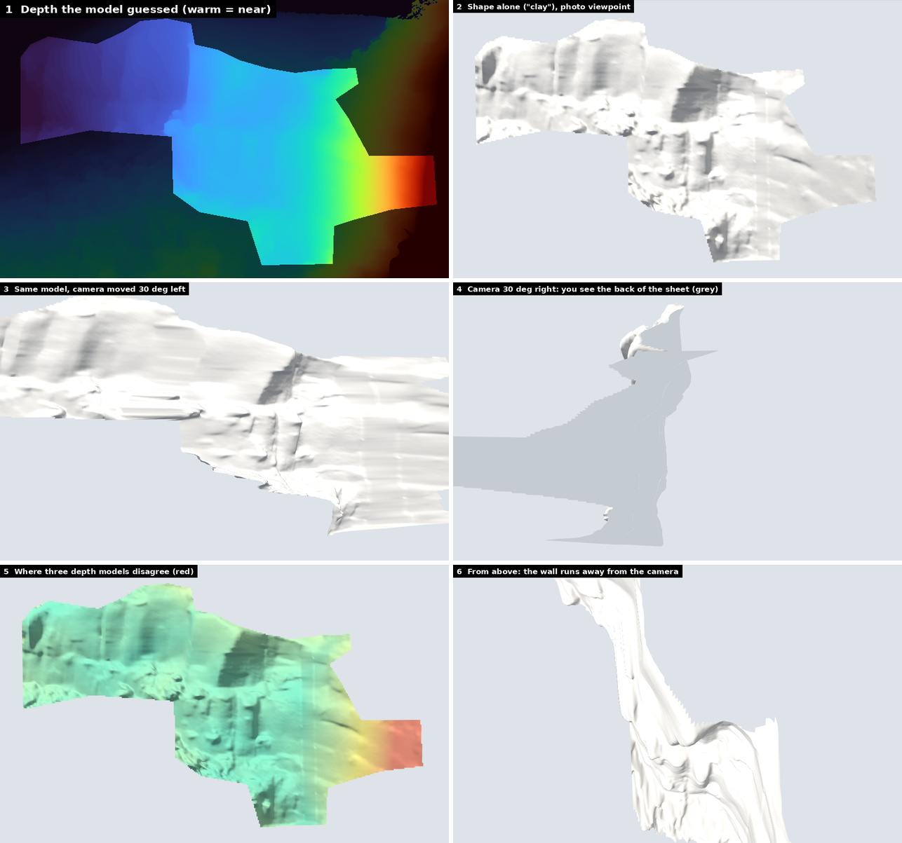
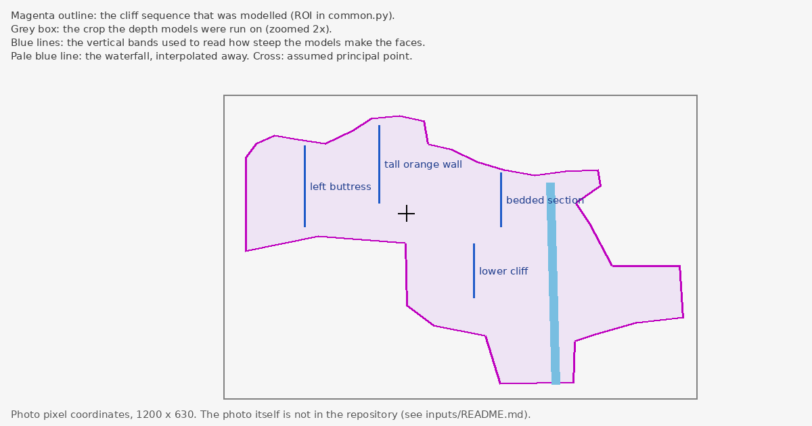
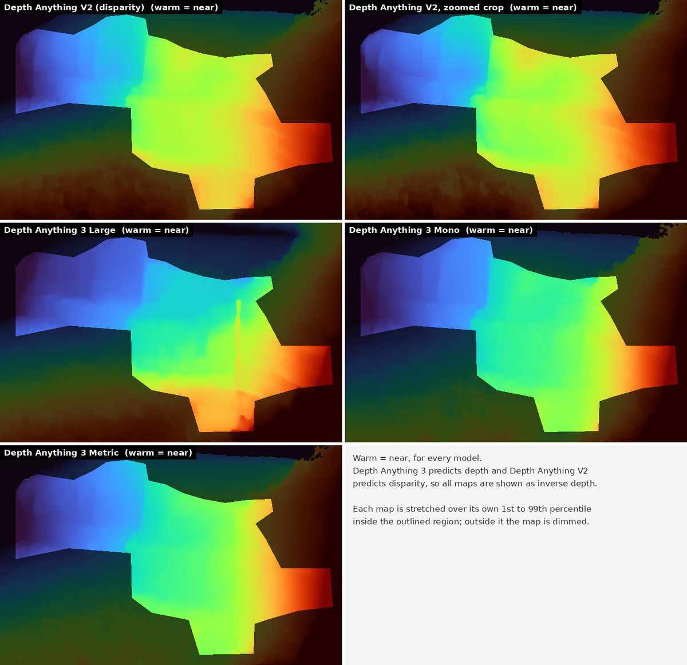

# Study 01: single-photo depth for a cliff sequence

*2026-10-12 · first pass · topic: [cliff from photo](../README.md) · not part of the app*

## Question

With one photo of a cliff and nothing else, how good a 3-D model can we make of its central cliff sequence, and what in it can be trusted?

## Short answer

- **It gives a relief sheet, not a measured model.** The photo is draped on a depth map that AI models guessed from the picture alone. Every
  point sits on its own line of sight from the camera, so from the photo's viewpoint it reproduces the photo exactly. The shape alone
  (a "clay" render) shows joint grooves on the left buttress, ledge steps and a recessed panel.
- **It holds up near the photo's viewpoint.** At the depth the model guessed, 94 % of the picture still looks right with the camera 30 degrees
  to the left, 87 % at 45 degrees; to the right only 76 % at 15 degrees, and at 30 degrees 41 % of the sheet is seen from behind.
  Flattening the depth widens that (table in finding 5).
- **Layout is stable, steepness is not.** Five depth maps agree on what is nearer (rank correlation 0.91 to 0.99), but one model leans the same
  vertical faces back by 27 to 50 degrees while the two that were used keep them within about 26 degrees of vertical. Agreement between the
  models is not evidence of accuracy: they share training lineage.
- **Scale, wall direction and ledge depth are guesses.** The metric model put the cliff at 4 to 9 m; the study assumes 600 m, and every size
  scales with that.
- **The ledge-scale detail is either a model's prior or invented.** The optional "invented detail" layer, which pushes thin dark lines in the
  photo back as ledges and joints, makes the clay look richer but adds no information.



## The photo and the region

The photo is **not in the repository** (public repository, licence unknown): see [`inputs/README.md`](inputs/README.md) for its checksum
and what to do about it. The region that was modelled, the crop the models were run on and the four bands used to read how steep the faces are
look like this (drawn on a blank canvas the size of the photo):



## Method

1. **Depth.** Four Depth Anything models (table below), on the whole photo and, for the two the mesh uses, on a 2x zoomed crop of the region.
   The mesh is built from Depth Anything 3 Mono on the crop; Metric and V2 serve only as cross-checks and for the disagreement map.
2. **Camera.** A pinhole camera with the photo centre as principal point and the focal length from Depth Anything 3 Large's own intrinsics
   estimate: 1033 px for the 1200 px wide photo, a horizontal field of view of 60.3 degrees. The photo has no EXIF.
3. **Scale (assumed).** The median distance from the camera to the face is set to 600 m (`ASSUMED_DISTANCE_M` in `scripts/common.py`).
4. **Waterfall.** The thin ribbon of water is not rock and the models give it a surface of its own, so the depth under it is interpolated away.
5. **Mesh.** One vertex per 2 photo pixels inside the outlined region, each at its predicted depth along its line of sight; 32,735 vertices and
   64,344 triangles. A quad would be dropped for a depth jump above 1.5x or a triangle for being edge-on to the camera; none were.
6. **Disagreement map.** Depth Anything 3 Metric and V2 are aligned to the Mono depth with a robust affine fit in inverse-depth space; the
   remaining difference, as a fraction of the face's depth range, is stored per vertex.
7. **Invented detail (optional).** Thin dark lines in the photo's rock-coloured pixels are pushed back by up to 2.5 m. Not measured.
8. **Viewer and files.** A three.js page with a depth-strength slider (100 % = what the model guessed, 0 % = a flat poster; each point moves
   along its own line of sight, so the photo view never changes), and glTF files.

| Run | Model | Revision | Licence | Used for |
|---|---|---|---|---|
| DA3 Large | `depth-anything/DA3-LARGE-1.1` | `0e109ae` | Apache-2.0 | the camera estimate; a third opinion on steepness |
| DA3 Mono | `depth-anything/DA3MONO-LARGE` | `f465978` | Apache-2.0 | **the depth the mesh is built from** |
| DA3 Metric | `depth-anything/DA3METRIC-LARGE` | `4010e39` | Apache-2.0 | cross-check, disagreement map, scale check |
| V2 Large | `depth-anything/Depth-Anything-V2-Large-hf` | `7581137` | **CC-BY-NC-4.0** | cross-check only: non-commercial, so it cannot go into the product |

Full revisions are in [`data/models.json`](data/models.json). The Depth Anything 3 Giant and Nested models are also CC-BY-NC and were not used.

## Findings

Numbers are in [`results/evaluation_depth_models.txt`](results/evaluation_depth_models.txt) and
[`results/evaluation_mesh.txt`](results/evaluation_mesh.txt). They were recomputed from the stored float16 depth maps, so they can differ
from the first run by one unit in the last digit.



### 1. The layout is stable across models

All five maps put the left buttress farthest and the lower right end nearest, with a step at the corner between the left buttress and the
bedded section. Rank agreement inside the region is 0.91 to 0.99 (the lowest pair is V2 on the zoomed crop against DA3 Large). The zoomed
crop and the whole-photo run of the same model agree at 0.99 to 1.00. DA3 Large gives the waterfall a surface of its own (the thin stripe in
its map); the study removes that from the depth it uses.

### 2. Steepness depends on the model

Lean of four vertical bands out of the vertical, from the depth at the top and base of each (degrees; positive = the top leans back, negative =
the top leans toward the camera; real sandstone faces here are close to vertical). Whole-photo runs:

| Band | DA3 Large | DA3 Mono | DA3 Metric |
|---|---|---|---|
| left buttress | +27 | -11 | -9 |
| tall orange wall | +32 | +1 | -14 |
| bedded section | +29 | -10 | -19 |
| lower cliff | +50 | +1 | +4 |

Mono and Metric agree with each other and keep the faces within about 20 degrees of vertical (within 26 on the zoomed crop). DA3 Large leans
every band back. A single model's steepness from one photo cannot be taken at face value; it needs a prior such as "cliff faces here are near
vertical". V2 gives -4 to -39 degrees, but it predicts disparity and needs an unknown offset to become depth, so it is shown in the evaluation
file and not used for this claim.

### 3. What the mesh says about the faces

From the Mono depth on the crop (photo-area weighted medians): the median tilt of the faces is 0 degrees, i.e. vertical (left buttress -7, leaning
toward the camera; bedded section and lower cliff 0), and 53 % of the photo area is steeper than 75 degrees (the rest is mostly the vegetated
benches between the rock bands). The model reads the wall as running mostly along the line of sight: the median angle between the line of sight
and the face normal is 63 degrees (60 for the left buttress, 64 for the bedded section and lower cliff, 79 for the lower right cliff). That
direction cannot be checked from one photo.

### 4. Scale cannot be recovered

The metric head (metres = canonical depth x focal / 300) puts the whole region at 4.0 to 8.7 m from the camera, median 5.9 m. That is wrong
for a cliff across a valley: the head is trained on near-range scenes and does not extrapolate to a landscape. With the assumed 600 m the
region is 402 m wide and 258 m high, and lies 244 m (1st percentile) to 1,108 m (99th) from the camera. Every figure scales with the assumption.

### 5. How far from the photo's viewpoint it holds up

Share of the photo's area that is front-facing and not stretched more than 3x in area, as the camera moves around the cliff on a circle
through the photo's viewpoint (negative = to the left). Occlusion by other parts of the sheet is not counted.

| Depth strength | -60 | -45 | -30 | -15 | 0 | +15 | +30 | +45 | +60 |
|---|---|---|---|---|---|---|---|---|---|
| 100 % (as guessed) | 75 | 87 | 94 | 98 | 100 | 76 | 59 | 44 | 32 |
| 50 % | 89 | 95 | 98 | 99 | 100 | 98 | 76 | 60 | 42 |
| 25 % | 96 | 98 | 99 | 100 | 100 | 99 | 98 | 92 | 62 |

The right side fails first because the guessed wall faces left: from the right you look at its back (`back` column in the evaluation file).

### 6. Where the models disagree

Median disagreement is 2.2 % of the face's depth range, and 10.1 % at the 90th percentile. It is largest at the lower right end of the
region, next to the foreground trees (panel 5 of the overview). The two models used for the comparison share a backbone family with the mesh's
own model, so low disagreement elsewhere is weak evidence.

### 7. The invented detail

22 % of the vertices are pushed back by more than 0.5 m, by up to 2.5 m. In the clay render it adds grain and thin grooves where the photo
has thin dark lines. Dark lines in a photo are also stains and shadows, so it is not geometry.

## What this means for FireSim

- A photo-derived mesh is **not a source of terrain** for the app: no scale, no wall direction, no measured ledge depth.
- The more promising uses need no 3-D reconstruction: **rock character** (ledge spacing, joints, overhang share, colours), **bare rock versus
  vegetation** and where the chutes are, and the **profile** of the edge. See the open questions in [the topic README](../README.md).
- The one result that matters for the plan's cliff work (section 9d): depth models disagree about steepness by tens of degrees, so a photo
  would be a reference for judging the procedural look, not a source of the steepness itself.

## Limits

- One photo of one cliff; no ground truth, so nothing here is validated against the real shape.
- The photo has no EXIF, so the camera is a model estimate, and the principal point is assumed to be the photo centre.
- The depth models were trained mostly on near-range scenes, and all four descend from the same research line.
- The viewing-cone numbers are area based. They ignore parts of the sheet hiding other parts, and the 3x stretch threshold is a choice.
- The waterfall removal and the invented detail are choices of this study, not outputs of the models.

## Reproduce

```sh
python3 -m venv .venv && . .venv/bin/activate
pip install -r requirements.txt          # read the comments in it: CPU-only torch, and Depth Anything 3 is installed without its dependencies
cp /path/to/photo.jpg inputs/photo.jpg   # step 1 only; steps 2 to 7 run from data/
scripts/run_all.sh                       # START=2 scripts/run_all.sh skips the model runs
```

Step 1 took about 12 minutes in the sandbox, almost all of it loading 1.3 GB models from a cold disk (inference took 12 to 45 seconds a
run); steps 2 to 6 take seconds; step 7 about a minute and needs a Chromium (`CHROMIUM_PATH`).

## Files

| Path | What |
|---|---|
| `scripts/common.py` | every assumption and constant: region, crop, waterfall, assumed distance, mesh settings |
| `scripts/step1_depth.py` | runs the depth models; writes `data/*.npz`, `camera.json`, `models.json` |
| `scripts/step2_compare_models.py` | agreement, lean per band, metric scale check; the depth-map figure |
| `scripts/step3_build_mesh.py` | the mesh, the disagreement map, the invented detail; writes `data/mesh.npz` |
| `scripts/step4_export.py` | glTF export (geometry only here; textured versions into `work/` when the photo is present) |
| `scripts/step5_evaluate.py` | face orientation and the viewing-cone table |
| `scripts/step6_viewer.py`, `viewer_template.html` | the interactive three.js page |
| `scripts/step7_figures.py` | the renders and the overview figures |
| `data/` | depth maps (float16), camera, model revisions, the mesh: 3 MB, no photo pixels |
| `results/` | `overview.png`, `depth_models_compared.png`, `region_outline.png`, two evaluation texts, `mesh_stats.json`, `cliff_central_sequence_geometry.glb` |
| `work/` (git-ignored) | everything that contains the photo: textured models, the viewer page, the figure with the photo |
